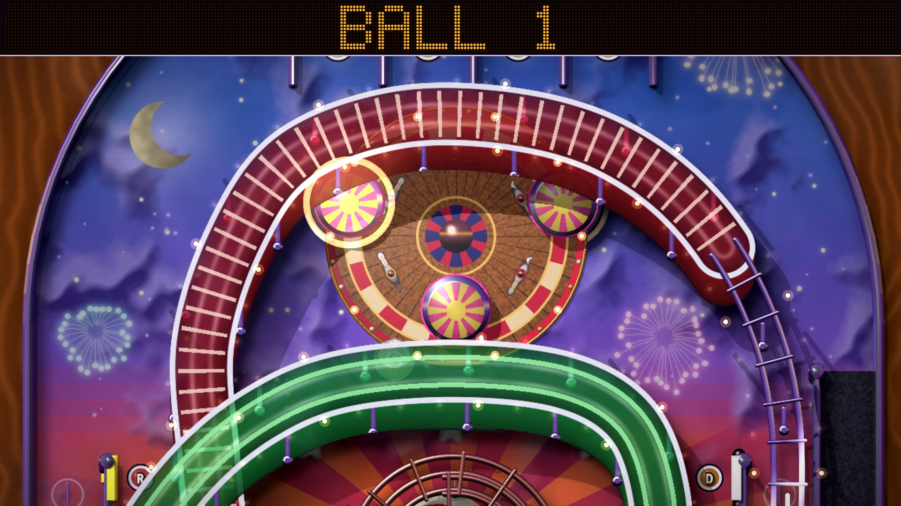
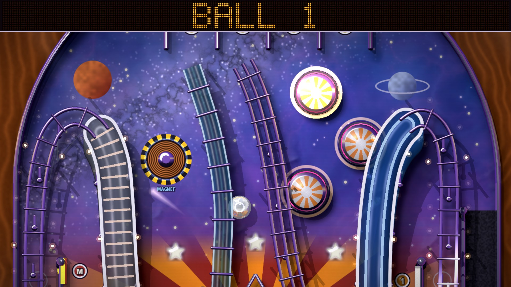
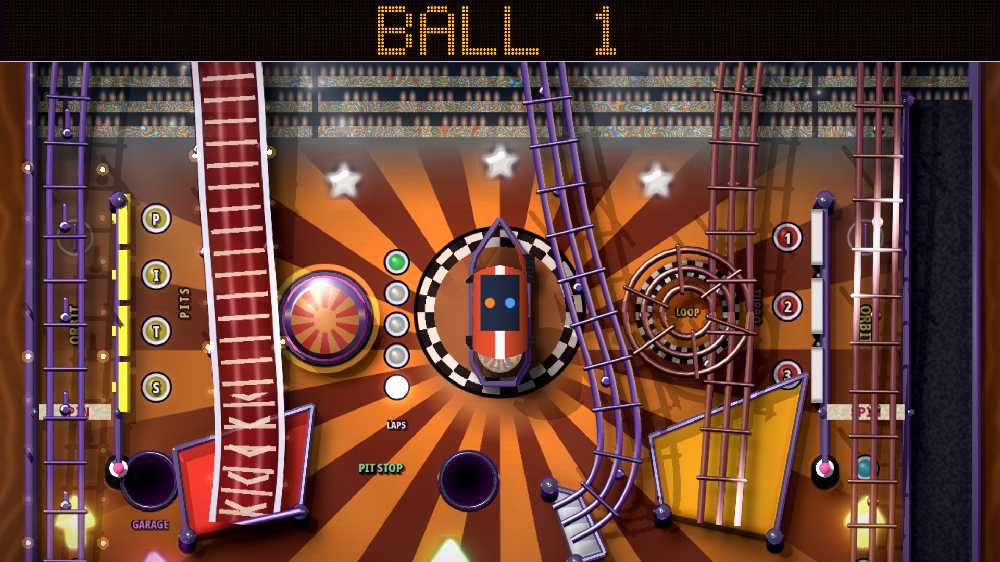

# Copper Tilt

**Pinball 2D w duchu Amigi** (Pinball Dreams / Fantasies / Illusions, Slam Tilt).
Trzy stoły, widok 3D z góry z cieniami i światłami (albo klasyczny widok 2D), tryby, multiball, MATCH na koniec gry,
muzyka w stylu trackerów Amigi. Do tego osobna **wersja terminalowa** (jeden plik Pythona).

*An Amiga-style 2D pinball made in Godot 4.7, plus a single-file terminal version. English summary below.*

## 📥 Pobierz grę

**Gotowe pliki dla Windows i Linuksa: [github.com/Adam-LX/coppertilt-releases/releases](https://github.com/Adam-LX/coppertilt-releases/releases/latest)**
(szczegóły w [DOWNLOADS.md](DOWNLOADS.md))

| Plik | Co to jest |
|---|---|
| `CopperTilt-windows-x86_64.zip` | gra (Windows 10/11, 64-bit): rozpakuj i uruchom `CopperTilt.exe` |
| `CopperTilt-linux-x86_64.zip` | gra (Linux, 64-bit): rozpakuj i uruchom `CopperTilt.x86_64` |
| `CopperTilt-terminal-linux-x86_64` | wersja terminalowa na Linuksa, jeden plik, bez instalowania |
| `CopperTilt-terminal-windows-x86_64.zip` | wersja terminalowa na Windows (uruchom `CopperTilt-terminal.bat`) |
| `coppertilt_tty.pyz` | wersja terminalowa dla każdego systemu z Pythonem 3 |

## 🎱 Stoły

| Midnight Funfair | Launch Pad | Copper Speedway |
|---|---|---|
|  |  |  |

## 🎮 Sterowanie

| Klawisz | Akcja |
|---|---|
| **Lewy Shift / Lewy Ctrl / Z / ←** | lewa łapka |
| **Prawy Shift / Prawy Ctrl / M / `/` / →** | prawa łapka |
| **Spacja / Enter / ↓** | wyrzutnia kulki (przytrzymaj i puść), start gry |
| **X / N / ↑ (albo B)** | szturchnięcie stołu w lewo / w prawo / w górę (za dużo = TILT) |
| **P** | pauza |
| **Esc** | wstecz / menu |
| **F11** albo **Alt+Enter** | pełny ekran / okno |
| **F9** | styl pikselowy (wymusza widok 2D) |
| **F10** | wygładzanie skalowania |
| **F7 / F8** | tempo gry wolniej / szybciej |

Pad też działa (bumpery/triggery = łapki, A = wyrzutnia, krzyżak = szturchanie).

W menu tytułowym (OPTIONS): **VIEW** (3D / 2D CLASSIC), **3D SHADOWS**, **LIGHT FX** (OFF / LOW / HIGH), **GAME SPEED**. Teksty w grze są po angielsku.
Domyślnie gra startuje w pełnym ekranie, w widoku 3D.

## ▶️ Uruchomienie ze źródeł (Godot 4.7)

1. Zainstaluj [Godot 4.7](https://godotengine.org/) (wersja standardowa, nie .NET).
2. Sklonuj repo i uruchom:
   ```bash
   git clone https://github.com/Adam-LX/coppertilt.git
   cd coppertilt
   godot --path .
   ```
   Opcje z linii poleceń (po `--`): `--view=2d|3d`, `--shadows=0|1`, `--lightfx=0..2`, `--windowed`.

## 💻 Wersja terminalowa

Jeden plik, sam Python 3 (bez dodatkowych bibliotek), stół Midnight Funfair w terminalu:

```bash
python3 tools/terminal/coppertilt_tty.py            # gra
python3 tools/terminal/coppertilt_tty.py --autoplay # demo, gra komputer
```

Sterowanie: **Z / ←** lewa łapka, **M / →** prawa łapka, **Spacja / ↓ / Enter** wyrzutnia,
**X / N / ↑** szturchanie, **P** pauza, **Q / Esc** wyjście. Terminal nie zgłasza puszczenia klawisza,
więc łapka trzyma się przez `--hold` sekund (domyślnie 0,45). Najlepiej w dużym oknie terminala.
Na Windows: `pip install windows-curses`, potem tak samo (albo gotowa paczka z Releases).

## 🔊 Grafika, dźwięk i muzyka

Wszystko jest nasze: stoły, grafika, dźwięki i muzyka są generowane skryptami z `tools/`
(`tools/*_art.py`, `tools/gen_audio.py`, `tools/gen_ballsound.py`, tracker `tools/amigamusic/`).
Gra nie zawiera żadnych zasobów z innych gier. Nazwy klasycznych pinballi to tylko inspiracja stylem.

## 📄 Licencja

[MIT](LICENSE): kod i zasoby.

---

## English

**Copper Tilt** is a 2D pinball in the spirit of the Amiga classics. Three tables (Midnight Funfair, Launch Pad, Copper Speedway),
an optional top-down 3D view with real-time shadows and lights (or the classic 2D view), modes, multiball, a MATCH lottery,
and Amiga tracker-style music. All art, sound and music are original and generated by the scripts in `tools/`.

- **Download** Windows/Linux builds: <https://github.com/Adam-LX/coppertilt-releases/releases/latest>
- **Run from source:** Godot 4.7 → `godot --path .`
- **Terminal version:** `python3 tools/terminal/coppertilt_tty.py` (Python 3 stdlib only; on Windows add `pip install windows-curses`)
- **Controls:** Shift/Ctrl/Z/← left flipper, Shift/Ctrl/M/→ right flipper, Space/Enter plunger, X/N/↑ nudge, P pause, F11 fullscreen.
- **License:** MIT.
